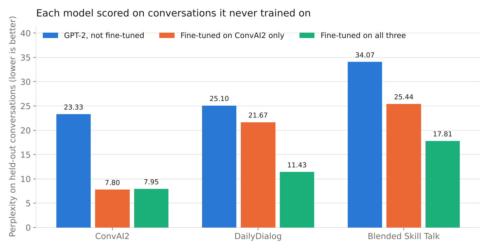
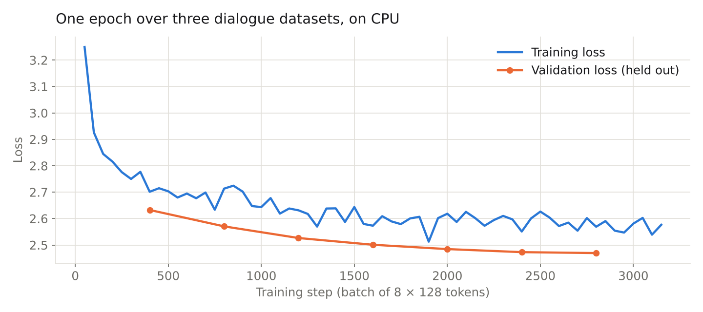

# AI Assistant: GPT-2 fine-tuned for conversation

A small dialogue assistant: GPT-2 (124M parameters) fine-tuned on three sets
of everyday conversations (ConvAI2, DailyDialog and Blended Skill Talk),
served by a Flask API with a web page, a Tkinter desktop app, a Streamlit app
and a React front end.

I first built it in 2023 and 2024 as my first hands-on language-model
project, trained on a CPU on ConvAI2 plus some dialogues I wrote myself (that
file has since been lost; the copy in the repository is empty). In November
2026 I went back to it, fixed what was wrong, measured it properly, and
retrained it on about five times as much conversation (see
[Changes](#changes-november-2026)).


*The 2026 model in the web page (`?seed=11` makes the conversation repeatable). It takes turns and can be kind, but it forgets: a dog called Mike becomes "i love cats" one turn later.*

> It makes small talk, nothing more. A 124M-parameter model trained on
> chit-chat does not know facts and will happily invent them.

## Results

Each model is scored on whole conversations it never saw in training:
269 ConvAI2 dialogues held out with a fixed seed, and the official
validation splits of DailyDialog (1,000 dialogues) and Blended Skill Talk
(1,009). Perplexity, lower is better; the same 128-token blocks for every
model, in full precision:

| Model | ConvAI2 | DailyDialog | Blended Skill Talk |
| --- | --- | --- | --- |
| GPT-2, not fine-tuned | 23.33 | 25.10 | 34.07 |
| Fine-tuned on ConvAI2 only (1 epoch) | **7.80** | 21.67 | 25.44 |
| Fine-tuned on all three (1 epoch) | 7.95 | **11.43** | **17.81** |



Training on all three keeps the ConvAI2 score within 2% of the specialist
model and cuts perplexity on the other two: 47% lower on DailyDialog
and 30% lower on Blended Skill Talk than the ConvAI2-only model. In plain
terms, it now fits ordinary written conversation, not just one dataset's
style of chit-chat.

Run details (`docs/2026-chat-run-metrics.json`): 18,363 training dialogues
(3.24 million tokens), 3,163 steps of 8 blocks of 128 tokens, learning rate
5e-5 with a cosine schedule, seed 42, validation every 400 steps and the best
checkpoint kept (step 2,800). About 2.5 hours on a 2-core CPU with bfloat16;
the machine restarted once and the run resumed from its last checkpoint.



Same prompts, same random seed (7), both fine-tuned models through the same
reply code:

| You | ConvAI2 only | All three datasets |
| --- | --- | --- |
| hi, how are you today? | i am fine , i am a bit tired from work , but i am getting ready to go to the gym . | i am fine , just got back from the gym . i am a big fan of hockey |
| what do you do for a living? | i am a construction worker, i am doing construction work. | i am a construction worker |
| do you have any pets? | i am a teacher , i am not sure what that means . | i have a dog and a cat |
| what music do you like? | i like music , i like to listen to music | i like music , but i also like to listen to music |
| i'm thinking of buying a new car. any advice? | i am not sure . i am a student , so i don't know . | i'd like to start a new business |
| can you recommend somewhere to eat tonight? | i am not sure . i am a student . | yes, we have a lot of seafood. |
| i failed my driving test today. | i am not sure what i mean. | i am sorry to hear that . |

Better on the pets and the driving test, still off topic on the car, and the
seafood reply is a waiter's line straight out of DailyDialog. Lower
perplexity means the model predicts real conversation better; it does not
make a 124M-parameter model helpful or truthful.

### Data and licences

- [ConvAI2](https://huggingface.co/datasets/conv_ai_2) (persona chit-chat).
- [DailyDialog](https://huggingface.co/datasets/roskoN/dailydialog) (Li et al., 2017): CC BY-NC-SA 4.0, so a model
  trained on it is for non-commercial use only. The trained weights are not published here.
- [Blended Skill Talk](https://huggingface.co/datasets/ParlAI/blended_skill_talk) (Smith et al., 2020).

The datasets are downloaded when you train, and nothing from them is stored in this repository.

## Run it

```bash
python -m venv .venv && source .venv/bin/activate      # Windows: .venv\Scripts\activate
pip install torch --index-url https://download.pytorch.org/whl/cpu   # or the CUDA build
pip install -r requirements.txt

python -m assistant.train --sources convai2,dailydialog,bst --out models/gpt2-chat   # downloads, trains, evaluates
python -m assistant.server --model models/gpt2-chat      # http://127.0.0.1:5000
```

Other clients, with the server running:

```bash
pip install -r requirements-clients.txt
streamlit run clients/streamlit_app.py
python clients/tkinter_app.py
cd frontend && npm install && npm start                  # React
```

`python -m assistant.train --max-steps 20 --out /tmp/smoke` is a two-minute check that everything works.
Training on one source (`--sources convai2`, the default) takes about 40 minutes on a 2-core CPU; all three
take about 2.5 hours. An interrupted run picks up from its last checkpoint when you run the same command again.
`--compare models/other-run` scores another model on exactly the same held-out blocks.
To add your own dialogues, pass `--custom file.jsonl` in the format of
`data/custom_dialogues.example.jsonl`; they only ever go into training, never
into the held-out set.

Tests: `pip install -r requirements-dev.txt && python -m pytest -q`. They use a
tiny random GPT-2, so they run in seconds without the trained model.

## How it works

- `assistant/data.py`: each conversation, from any of the three datasets,
  becomes lines labelled `User:` and `Assistant:`, so the model learns whose
  turn it is. DailyDialog's spaced-out punctuation ("it ' s") is put back
  together. ConvAI2 is split by whole dialogue with a fixed seed; the other
  two use their official validation splits.
- `assistant/train.py`: Hugging Face `Trainer`, causal language modelling on
  packed 128-token blocks, validation loss checked during training, the best
  checkpoint kept, early stopping, and resuming after an interruption. At the
  end, held-out perplexity is measured per dataset for the untuned model, any
  `--compare` models and the new one, on exactly the same blocks.
- `assistant/model.py`: builds the prompt from the conversation so far, samples
  a reply (top-p 0.9, top-k 50, temperature 0.7, no repeated 3-grams) and cuts it
  at the next speaker label.
- `assistant/server.py`: `POST /api/generate` with `{"input_text": ..., "history": [[user, assistant], ...]}`;
  empty or over-long input is refused with a 400.

## Changes (November 2026)

What I found when I ran the 2024 code again, and what changed:

| Found | Changed |
| --- | --- |
| Replies used greedy decoding. `temperature`, `top_k` and `top_p` were passed to `generate()` without `do_sample=True`, so Transformers ignored them, and replies were flat and repetitive. | Sampling is switched on, with a test that fails if it is ever dropped. |
| `max_length=50` counted the prompt, so a long question left little or no room for an answer. | `max_new_tokens` limits only the reply. |
| Training joined each conversation into one line with no speakers, so the model could not tell whose turn it was, and replies ran on into the next turn. | Turns are labelled `User:` / `Assistant:` and the reply is cut at the next label. |
| The React front end's backend was a placeholder that reversed the input text; it never reached the model. | All four interfaces use the one API. |
| `requirements.txt` was saved as UTF-16 (pip could not read it) and listed 130 packages, including TensorFlow and Django, that the project never used. | Seven direct dependencies in plain UTF-8. |
| The custom dataset file in the repository was empty, and there was no evaluation: replies were judged by reading them. | Custom dialogues are optional and documented; held-out perplexity against the untuned model is reported for every run. |
| Two training scripts were placeholders (three toy sentences) and used `transformers.AdamW`, which newer versions removed. | One training script, with arguments. |
| No tests or CI. | 14 tests and a GitHub Actions workflow. |
| One small dataset (2,426 training conversations), and the 2024 run took 3.6 hours on a CPU. | Three datasets, 18,363 training conversations, scored per dataset; bfloat16 makes one epoch over all of it about 2.5 hours on a 2-core CPU. |

The 2024 training log is kept in `docs/2024-training-log/` for the record:
3 epochs on a CPU, 2,622 steps, 3.6 hours; training loss 2.96 at step 500 and
2.21 at step 2,500.

The 2026 review and changes were made with Claude as a pair programmer.
