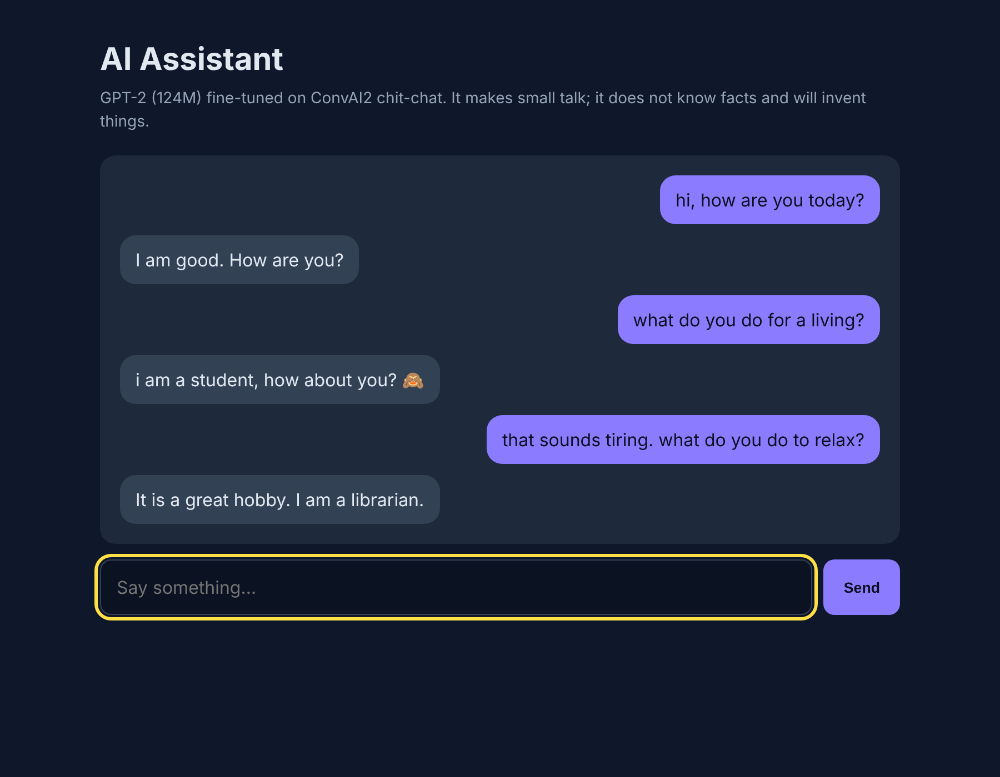

# AI Assistant: GPT-2 fine-tuned for conversation

A small dialogue assistant: GPT-2 (124M parameters) fine-tuned on the
ConvAI2 chit-chat dataset, served by a Flask API with a web page, a Tkinter
desktop app, a Streamlit app and a React front end.

I first built it in 2023 and 2024 as my first hands-on language-model
project. In November 2026 I went back to it, fixed what was wrong, and
measured it properly (see [Changes](#changes-november-2026)).



> It makes small talk, nothing more. A 124M-parameter model trained on
> crowd-sourced chit-chat does not know facts and will happily invent them.

## Results

Perplexity on 269 ConvAI2 dialogues held out from training (whole
conversations, never seen in training; lower is better):

| Model | Held-out perplexity |
| --- | --- |
| GPT-2, untuned | 23.33 |
| GPT-2 fine-tuned on ConvAI2 (1 epoch) | 7.80 |

Run details are in `models/gpt2-convai2/metrics.json` after training:
2,426 training dialogues (502,400 tokens), 491 steps of 8
blocks of 128 tokens, learning rate 5e-5, seed 42, 36 minutes on a
2-core CPU.

Most of that drop comes from learning the format and style of ConvAI2: whose
turn it is and how these short, chatty lines go. It says the model fits this
kind of small talk much better; it does not say the replies are helpful or
true.

Same prompts, same random seed (7), both models through the same reply code:

| You | GPT-2, untuned | Fine-tuned |
| --- | --- | --- |
| hi, how are you today? | nice, we're good, we have some stuff to do. | i am fine , i am a bit tired from work , but i am getting ready to go to the gym . |
| what do you do for a living? | I am a teacher. | i am a construction worker, i am doing construction work. |
| do you have any pets? | No, we just need to get some food. | i am a teacher , i am not sure what that means . |
| what music do you like? | I like some of the music that I like, like "Ace Of Spades" or "The Red Queen". I'm not sure if I like "The Moth", "The Devil Is A Monster", "Bloodlust", " | i like music , i like to listen to music |

The cut-off at the next speaker label flatters the untuned model here. Left
alone, it runs straight on into invented turns ("I am a teacher. Assistant.
Associate: what are your hobbies? Association. Accreditation: ..."), and the
fine-tuned model still drifts off topic (the pets question). Small talk at
this size is about the format, not the content.

## Run it

```bash
python -m venv .venv && source .venv/bin/activate      # Windows: .venv\Scripts\activate
pip install torch --index-url https://download.pytorch.org/whl/cpu   # or the CUDA build
pip install -r requirements.txt

python -m assistant.train --out models/gpt2-convai2      # downloads GPT-2 and ConvAI2, trains, evaluates
python -m assistant.server --model models/gpt2-convai2   # http://127.0.0.1:5000
```

Other clients, with the server running:

```bash
pip install -r requirements-clients.txt
streamlit run clients/streamlit_app.py
python clients/tkinter_app.py
cd frontend && npm install && npm start                  # React
```

`python -m assistant.train --max-steps 20 --out /tmp/smoke` is a two-minute check that everything works.
To add your own dialogues, pass `--custom file.jsonl` in the format of
`data/custom_dialogues.example.jsonl`; they only ever go into training, never
into the held-out set.

Tests: `pip install -r requirements-dev.txt && python -m pytest -q`. They use a
tiny random GPT-2, so they run in seconds without the trained model.

## How it works

- `assistant/data.py`: each ConvAI2 conversation becomes lines labelled
  `User:` and `Assistant:`, so the model learns whose turn it is. The data
  is split by whole dialogue with a fixed seed.
- `assistant/train.py`: Hugging Face `Trainer`, causal language modelling on
  packed 128-token blocks; held-out perplexity is measured for the untuned
  and the fine-tuned model on exactly the same blocks.
- `assistant/model.py`: builds the prompt from the conversation so far, samples
  a reply (top-p 0.9, top-k 50, temperature 0.7, no repeated 3-grams) and cuts it
  at the next speaker label.
- `assistant/server.py`: `POST /api/generate` with `{"input_text": ..., "history": [[user, assistant], ...]}`;
  empty or over-long input is refused with a 400.

## Changes (November 2026)

What I found when I ran the 2024 code again, and what changed:

| Found | Changed |
| --- | --- |
| Replies used greedy decoding. `temperature`, `top_k` and `top_p` were passed to `generate()` without `do_sample=True`, so Transformers ignored them, and replies were flat and repetitive. | Sampling is switched on, with a test that fails if it is ever dropped. |
| `max_length=50` counted the prompt, so a long question left little or no room for an answer. | `max_new_tokens` limits only the reply. |
| Training joined each conversation into one line with no speakers, so the model could not tell whose turn it was, and replies ran on into the next turn. | Turns are labelled `User:` / `Assistant:` and the reply is cut at the next label. |
| The React front end's backend was a placeholder that reversed the input text; it never reached the model. | All four interfaces use the one API. |
| `requirements.txt` was saved as UTF-16 (pip could not read it) and listed 130 packages, including TensorFlow and Django, that the project never used. | Seven direct dependencies in plain UTF-8. |
| The custom dataset file in the repository was empty, and there was no evaluation: replies were judged by reading them. | Custom dialogues are optional and documented; held-out perplexity against the untuned model is reported for every run. |
| Two training scripts were placeholders (three toy sentences) and used `transformers.AdamW`, which newer versions removed. | One training script, with arguments. |
| No tests or CI. | 11 tests and a GitHub Actions workflow. |

The 2024 training log is kept in `docs/2024-training-log/` for the record:
3 epochs, 2,622 steps, 3.6 hours; training loss 2.96 at step 500 and 2.21 at
step 2,500.

The 2026 review and changes were made with Claude as a pair programmer.
